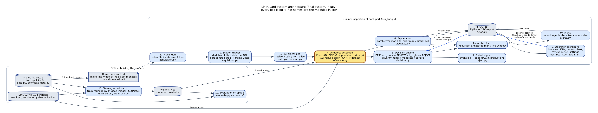

# LineGuard: camera-based defect inspection for a production line

ICT304 group project, Murdoch University (group Sentinel Vision). LineGuard watches parts
pass a camera, scores each one with an anomaly-detection model, decides **PASS / REVIEW /
REJECT**, fires a reject signal, records every decision in a QC log, and shows an operator
dashboard with KPIs, a control chart, alerts and a review queue.

Assignment 1 delivered the AI subsystem (two techniques compared). The final system adds a
third, stronger technique and every non-AI subsystem around it. Everything runs on a laptop
CPU; the demo needs no dataset and no training.



| # | Subsystem | What it does | Module |
|---|---|---|---|
| 1 | Acquisition | reads a video file, a webcam or an image folder | `src/acquisition.py` |
| 2 | Station trigger | finds the part in the inspection station, centres a crop on it, votes over N frames | `src/acquisition.py` |
| 3 | Pre-processing | resize, scale / normalise for the model | `src/data.py`, `src/foundad.py` |
| 4 | **AI defect detection** | anomaly score + heatmap (three techniques, below) | `src/inference.py` |
| 5 | Decision engine | PASS / REVIEW / REJECT with two thresholds, severity bands | `src/decision.py` |
| 6 | Explanation | heatmap of where the defect is | `src/visualize.py` |
| 7 | Reject signal | reject event log + beep (a PLC output in production) | `src/reject.py` |
| 8 | QC log | SQLite database of every decision, CSV export | `src/qclog.py` |
| 9 | Operator dashboard | live view, KPIs, control chart, review queue, settings | `src/dashboard.py` |
| 10 | Alerts | reject-rate spike (p-chart), camera stall | `src/alerts.py` |
| | Line runner | wires 1-10 together, writes the annotated feed | `src/run_line.py` |

## The three AI techniques

| | 1. Convolutional autoencoder | 2. ResNet-18 classifier | 3. FoundAD-style detector (primary) |
|---|---|---|---|
| Learns from | 188 good bottles | 198 good + 31 labelled defect bottles | **4 good bottles** |
| How | rebuilds good bottles; defects rebuild badly | supervised, ImageNet-pretrained | frozen DINOv2 foundation encoder + a small predictor trained to project patch features onto the "normal" manifold (Zhai et al., 2025) |
| Heatmap | pixel rebuild error | Grad-CAM (7×7) | 32×32 patch feature error |
| New defect types | flagged | only the 3 trained types | flagged |

Results on the held-out split B (42 images, 10 good, 32 defect; nothing trained on them) are in
[`results/SUMMARY.md`](results/SUMMARY.md): the FoundAD-style detector reaches the highest image
AUROC while using only 4 good images and no defect image, which is why it is the line's primary
detector. The other two remain selectable with `--model ae` / `--model cnn`.

## 1. Quick start: run the line (about 10 minutes)

Install [Python 3.12 or 3.13 (64-bit)](https://www.python.org/downloads/). Supported platforms:
Windows 10/11, 64-bit Linux, Apple Silicon macOS 14+ (the pinned PyTorch has no Intel-Mac or
Python 3.15 build). On Windows use a short path such as `C:\lineguard`.

Open a terminal in the project folder (the one containing `README.md`) and create the environment.
On Windows use `py -3.13` for Python 3.13:

```
py -3.12 -m venv .venv
.venv\Scripts\python -m pip install -r requirements.txt
.venv\Scripts\python -m src.download_backbone
```

macOS / Linux (replace `.venv\Scripts\python` with `.venv/bin/python` in every command below):

```
python3.12 -m venv .venv
.venv/bin/python -m pip install -r requirements.txt
.venv/bin/python -m src.download_backbone
```

On Linux install the smaller CPU build of PyTorch first:
`.venv/bin/python -m pip install torch==2.14.1 torchvision==0.29.1 --index-url https://download.pytorch.org/whl/cpu`.

`download_backbone` fetches the DINOv2 encoder weights once (88 MB, SHA-256 checked, Apache 2.0).
After that nothing needs the internet.

**Run the line on the recorded camera feed** (21 real held-out bottles moving along a belt,
`samples/line_demo.mp4`, 72 s):

```
.venv\Scripts\python -m src.run_line --source samples/line_demo.mp4 --reset
```

Each part prints one line as it is decided (this is the committed run, `results/line_demo_run/run_log.txt`;
the part ids carry the run's start time; on another CPU the scores can differ in the last digits):

```
Running on samples/line_demo.mp4: station ROI(x=240, y=60, w=800, h=600), 5 frame votes per part, FoundAD (DINOv2 few-shot) on cpu. Writing results/line/ ...
063949-0001  score 2.1972  PASS  [5 frames, t_low 3.144, t_high 3.264]
REJECT SIGNAL -> 063949-0002 (moderate, score 6.5808): divert
063949-0002  score 6.5808  REJECT (moderate)  [5 frames, t_low 3.144, t_high 3.264]
063949-0003  score 1.6885  PASS  [5 frames, t_low 3.144, t_high 3.264]
...
Done: 21 parts this run; QC log now holds 21 (10 PASS, 0 REVIEW, 11 REJECT). Reject signals fired: 11. Outputs in results/line/
```

The feed takes about 100 s on a 2-core CPU (72 s of video); all 21 parts are decided in agreement
with their labels (10 good PASS, 11 defects REJECT, see `docs/report_inputs.md` §9).

and writes to `results/line/`: `qc_log.sqlite` (every decision), `reject_events.jsonl`,
`parts/` (the crop and heatmap of every part) and `line_demo_annotated.mp4` (the feed with the
station, verdicts, counters and heatmap drawn on; open it in any video player). Add `--display`
to watch the annotated frames in a window while it runs (`q` quits).

**Open the operator dashboard** in a second terminal while (or after) the line runs:

```
.venv\Scripts\streamlit run src/dashboard.py
```

It opens in the browser (http://localhost:8501) and refreshes every 2 s from the QC log: counts,
reject rate, line status, the latest part with its heatmap, the control chart, alerts, the review
queue (confirm REVIEW parts as good or defect) and the settings form. Settings saved there
(REVIEW / REJECT thresholds, severity bands, alert limits) are used by the line runner from its
next part: no restart, no retraining. "Download the full log as CSV" exports everything.

**Other sources.** The same command reads a webcam or any video file, and replays a folder of
part images with one decision per image:

```
.venv\Scripts\python -m src.run_line --source 0 --display          # webcam 0, live
.venv\Scripts\python -m src.run_line --source my_recording.mp4     # a recording of a real line
.venv\Scripts\python -m src.run_line --source samples/ --model ae  # folder replay, autoencoder
```

Options: `--roi x,y,w,h` places the inspection station in the frame (default is the demo video's
station); `--votes N` frames scored per part (median wins; default 5); `--dark` grey level
separating the part from the backlit belt (default 160); `--reverse` for parts travelling right to
left; `--model ae|cnn|foundad`.

**Per-image demo** (the Assignment 1 command, all three models):

```
.venv\Scripts\python -m src.demo --model foundad --input samples/
.venv\Scripts\python -m src.demo --model ae --input samples/broken_small_010.png
```

prints score, threshold and OK / REJECT per image and saves an image | heatmap | verdict figure
to `results/demo/`.

## 2. Reproduce everything (download, train, evaluate, test)

Run from the project folder with the same Python (written as `python` below).

| Step | Command | What it does | Time |
|---|---|---|---|
| Download data | `python -m src.download_data` | MVTec AD `bottle`, 357 files, 157 MB into `data/mvtec/bottle/`, every image SHA-256 checked. Safe to re-run. | ~1 min |
| Download encoder | `python -m src.download_backbone` | DINOv2 ViT-S/14 weights into `weights/` (88 MB, hash-checked) | ~1 min |
| Check data | `python -m src.data --check` | image counts per folder; reports anything missing | seconds |
| Train technique 1 | `python -m src.train_ae` | autoencoder → `weights/ae.pt` (weights + threshold) | GPU ~20 s, CPU ~4 min |
| Train technique 2 | `python -m src.train_cnn` | ResNet-18 → `weights/cnn.pt` (downloads ImageNet weights once) | GPU ~2.5 min, CPU ~7 min |
| Train technique 3 | `python -m src.train_foundad` | predictor on 4 good images with CutPaste, 1000 steps → `weights/foundad.pt` (predictor + both thresholds) | CPU ~1.7 h on 2 cores (`--resume` continues an interrupted run); on a GPU a few minutes (not measured) |
| Evaluate | `python -m src.evaluate` | scores split B on CPU with all three → `results/` (metrics, plots, heatmaps, `SUMMARY.md`) | ~2 min |
| Demo feed | `python -m src.make_line_video` | renders `samples/line_demo.mp4` from the 21 sample images (deterministic, seed 42) | ~15 s |
| Tests | `python -m unittest discover -s tests -v` | 134 unit tests for every subsystem plus an end-to-end run on a short rendered video | ~1.5 min |

Notes:

- Training overwrites `weights/`. To keep the included weights, add `--out my_weights/foundad.pt`
  (and `--results my_results`), then evaluate with `python -m src.evaluate --weights my_weights --out my_results`
  (copy the DINOv2 file into `my_weights/` or leave it in `weights/`, both are searched).
- The split is fixed in `splits/bottle_split.json` (`python -m src.data --make-split` rebuilds it from the
  seed and refuses to overwrite a different file). Every script fixes its seeds (42). Evaluation runs on
  the committed weights on CPU, so `python -m src.evaluate` reproduces the reported numbers exactly
  (timings vary by machine).
- `python -m src.train_foundad --shots 8 --steps 2000` trains on more images or longer; `--backbone vitb14`
  uses the larger DINOv2 ViT-B/14 (`python -m src.download_backbone --variant vitb14`, 346 MB, ~4x slower).

### Optional: train on an NVIDIA GPU

```
.venv\Scripts\python -m pip install torch==2.14.1 torchvision==0.29.1 --index-url https://download.pytorch.org/whl/cu130
```

The training scripts use the GPU automatically when one is available (`--device cpu` forces CPU).
Evaluation, the demo and the line runner default to CPU so that scores are the ones a marker reproduces.

## 3. How the data is used

MVTec AD provides defect-free training images and a mixed test set. The test set is divided into
splits A and B (50/50 within each folder, seed 42) so that labelled defects exist for the classifier
and for calibrating thresholds, while split B stays untouched for evaluation:

| Part | Images | Used for |
|---|---|---|
| train | 188 good | autoencoder training; CNN training; the 4 FoundAD images are drawn from here |
| val | 21 good | autoencoder early stopping; FoundAD REVIEW threshold (with the split-A good images) |
| split A | 41 (10 good, 31 defect) | CNN training; autoencoder and FoundAD REJECT threshold only |
| split B | 42 (10 good, 32 defect) | evaluation only, all three models |

The 21 images in `samples/` (and therefore the demo feed) are split-B images: no model has seen them.

## 4. How a part is decided

1. **Trigger.** On a backlit belt the part is the dark blob in the station ROI. It counts once it is
   fully inside (touches neither side), like a photocell trigger. A square crop centred on it, with the
   dataset's margin, is what the model sees, so the line matches the training photographs.
2. **Votes.** Up to N frames of the same part are scored; the part's score is their median, so one
   blurred frame cannot decide it. Decided parts are followed until they leave, so parts closer
   together than the station is wide are still separated.
3. **Decision.** `score < t_low` PASS; `t_low ≤ score < t_high` REVIEW (a person checks it);
   `score ≥ t_high` REJECT. `t_low` is the model's calibrated threshold (best F1 on split A, as in
   Assignment 1), so the evaluation's numbers still hold: a part at or above it does not pass.
   `t_high` is the mildest split-A defect score above every good image the model was calibrated on,
   so a REJECT is at least as anomalous as a defect seen in calibration and a good part is never
   rejected outright by the calibration rule; the autoencoder and CNN have no `t_high` of their own
   (empty band until the operator sets one). FoundAD scores only the patches on the part (Otsu foreground): the belt around
   it is not inspected, so codec noise or lighting on the belt cannot reject a part. REJECT severity is the score's excess over `t_high`: minor < 50 %,
   moderate < 150 %, severe beyond (operator-adjustable, scale-free so it works for any model).
4. **Record and act.** Every decision goes into the QC log with its score, both thresholds, the model
   version, the crop and the heatmap; a REJECT also fires the reject signal.
5. **Watch the process.** The alerts module runs a p-chart on the reject rate (baseline 5 %, window 20
   parts, 3 sigma) and a stall timer (10 s without a part). Both limits are settings in the dashboard.

## 5. Project layout

```
README.md                this guide
requirements.txt         exact library versions tested
src/common.py            fixed random seeds, CPU/GPU selection
src/download_data.py     fetch MVTec AD bottle (standard library only, SHA-256 checked)
src/download_backbone.py fetch DINOv2 weights (standard library only, SHA-256 checked)
src/data.py              layout check, fixed split, image transforms, dataset
src/models.py            ConvAutoencoder, build_resnet18()
src/dino.py              minimal DINOv2 ViT (loads the official weights; ~120 lines)
src/foundad.py           technique 3: predictor, CutPaste synthesis, top-K scoring
src/gradcam.py           Grad-CAM with PyTorch hooks
src/inference.py         one scoring path for all models; checkpoints
src/train_ae.py          train technique 1, threshold on split A
src/train_cnn.py         train technique 2
src/train_foundad.py     train technique 3 (few-shot), thresholds on split A / unseen good images
src/evaluate.py          evaluate all three on split B, write results/
src/demo.py              per-image command-line demo
src/acquisition.py       sources (video / camera / folder), station trigger, part crop
src/decision.py          PASS / REVIEW / REJECT, severity, frame votes
src/qclog.py             SQLite QC log, settings, alerts table, CSV export
src/reject.py            reject signal (event log + beep)
src/alerts.py            p-chart reject-rate spike, camera stall
src/run_line.py          the line runner (end to end) + annotated feed
src/dashboard.py         Streamlit operator dashboard
src/make_line_video.py   renders the demo camera feed from real sample images
src/visualize.py         training curves, image | heatmap | verdict figures, overlays
tests/                   unittest suite (standard library): one file per subsystem + end to end
splits/                  the committed split
weights/                 ae.pt, cnn.pt, foundad.pt (model + thresholds); DINOv2 file after download
samples/                 20 split-B images, line_demo.mp4 + manifest, ATTRIBUTION.md
results/                 metrics, plots, heatmaps, demo figures, logs, SUMMARY.md; line/ after a run
docs/                    report inputs, code walkthrough, architecture diagram, AI prompt log
```

## 6. Troubleshooting

| Problem | Fix |
|---|---|
| `No matching distribution found for torch==2.14.1` | Use 64-bit Python 3.12 or 3.13. On a Mac, PyTorch 2.14 needs Apple Silicon and macOS 14+. |
| pip fails with a long-path error (Windows) | Move the project to a short path such as `C:\lineguard`, delete `.venv`, recreate it. |
| `No module named src` | Run commands from the project folder (where `README.md` is). |
| `DINOv2 weights not found` | Run `python -m src.download_backbone` once (88 MB). |
| `Weights not found` | The `weights/` folder is missing: re-extract the full zip, or retrain (section 2). |
| `Could not open video source` | Check the path; for a webcam try `--source 0`, `--source 1`. On Linux the user needs access to `/dev/video*`. |
| The line decides nothing | The station does not see a dark part on a light background: adjust `--roi` and `--dark`, or `--reverse` if parts move right to left. |
| Dashboard shows "No QC log yet" | Start the line runner first, or pass `-- --db path/to/qc_log.sqlite`. |
| `Dataset folder not found` | Only training/evaluation need the dataset: `python -m src.download_data`. |
| Training was interrupted | `python -m src.train_foundad --resume` continues from the last progress checkpoint. |

## 7. Dataset, licences and references

**Dataset.** MVTec AD, category `bottle`. Copyright 2019 MVTec Software GmbH, licensed
[CC BY-NC-SA 4.0](https://creativecommons.org/licenses/by-nc-sa/4.0/) (non-commercial use).
Official source: https://www.mvtec.com/company/research/datasets/mvtec-ad. The download script uses the
Hugging Face mirror `foersben/mvtec-ad` pinned to commit `c75b39616f84db43677bcc8228caaafaf5096d7f`.
The dataset itself is not in this repository; the 21 sample images and the demo video rendered from
them are (see `samples/ATTRIBUTION.md`).

**Models and methods.**

- Zhai, G., Zhou, Y., Deng, X., Heckler, L., Navab, N., & Busam, B. (2025). Foundation visual encoders are
  secretly few-shot anomaly detectors. *arXiv:2510.01934*. Code: https://github.com/ymxlzgy/FoundAD (MIT).
  Technique 3 re-implements the method (frozen encoder, feature predictor, CutPaste context, top-K score).
- Oquab, M., Darcet, T., Moutakanni, T., et al. (2024). DINOv2: Learning robust visual features without
  supervision. *Transactions on Machine Learning Research*. Weights and code: https://github.com/facebookresearch/dinov2
  (Apache 2.0). `src/dino.py` is a minimal re-implementation that loads the official ViT-S/14 and ViT-B/14 weights.
- Li, C.-L., Sohn, K., Yoon, J., & Pfister, T. (2021). CutPaste: Self-supervised learning for anomaly detection
  and localization. *CVPR*. (synthetic defects used while training technique 3)
- Bergmann, P., Fauser, M., Sattlegger, D., & Steger, C. (2019). MVTec AD: A comprehensive real-world dataset
  for unsupervised anomaly detection. *CVPR* (pp. 9592–9600).
- Bergmann, P., Batzner, K., Fauser, M., Sattlegger, D., & Steger, C. (2021). The MVTec anomaly detection dataset.
  *International Journal of Computer Vision, 129*(4), 1038–1059.
- He, K., Zhang, X., Ren, S., & Sun, J. (2016). Deep residual learning for image recognition. *CVPR*. (ResNet-18)
- Deng, J., et al. (2009). ImageNet: A large-scale hierarchical image database. *CVPR*. (pretrained weights)
- Selvaraju, R. R., et al. (2017). Grad-CAM: Visual explanations from deep networks via gradient-based
  localization. *ICCV*.
- Montgomery, D. C. (2019). *Introduction to statistical quality control* (8th ed.). Wiley. (p-chart control limits)

**Libraries.** PyTorch 2.14.1 and torchvision 0.29.1 (models, training); NumPy, SciPy (Gaussian smoothing),
scikit-learn (AUROC, precision-recall), Matplotlib (figures), Pillow (images), OpenCV (video, camera,
annotated feed), Streamlit (dashboard), SQLite (standard library). Versions in `requirements.txt`.

The repository implements the data pipeline, split, autoencoder, classifier head, the DINOv2 model
definition, the FoundAD-style predictor and synthesis, training loops, threshold calibration, Grad-CAM,
evaluation, the demo and every line subsystem. It uses PyTorch layers and optimisers, torchvision's
ResNet-18 and ImageNet weights, Meta's DINOv2 weights, scikit-learn metrics, SciPy's Gaussian filter,
OpenCV's video I/O and connected components, and Streamlit's widgets.
