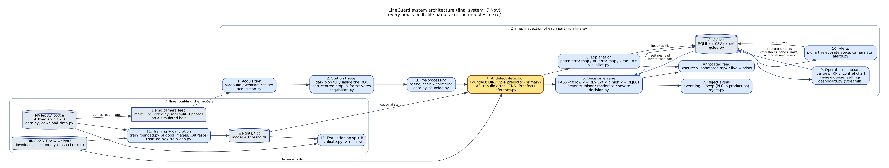

# LineGuard: inputs for the final report (7 Nov 2026)

For the documentation team. Facts, numbers and tables only; the report wording is yours.
Every result comes from `results/SUMMARY.md` (model evaluation) and `results/line_demo_run/`
(the end-to-end run); if this file and those ever disagree, they win. The Assignment 1
inputs are kept in `report_inputs_assignment1.md`; everything that was "Final" there is
now built and listed here.

## 0. Where to find what, per feedback-sheet criterion

| Criterion (weight) | Source |
|---|---|
| Requirement and focus (20%): title, abstract, domain, requirements, problem formulation, why it helps | §1, §2 (requirement status), Assignment 1 §3–6 unchanged |
| System design (35%): life cycle, overview + subsystems, technique justification, technique detail, optimisation, subsystem development, workflow and use, **demo video** | §3 (life cycle), §4 (subsystems), §5 (workflow), §6 (techniques), §7 (optimisation), `architecture.png`, §12 (video script) |
| Evaluation and results (20%): methodology, results format and metrics, comparison, conclusions, limitations, deployment and maintenance, **all subsystems tested** | §8 (model results), §9 (line results), §10 (test plan, all subsystems), §11 (limitations), §13 (deployment and maintenance) |
| User guide and code (15%) | `README.md` §1 (quick start), §2 (reproduce); screenshots in §14 |
| Content and format (10%) | references: `README.md` §7 |
| Group declaration | team |
| Interview preparation | `docs/walkthrough.md` |

## 1. Product (what changed since Assignment 1)

| Item | Value |
|---|---|
| Name | LineGuard |
| What it does now | Watches parts pass a camera (video file, webcam or image folder), finds each part in the inspection station, scores it, decides PASS / REVIEW / REJECT with a severity, fires a reject signal, logs every decision in SQLite, and shows an operator dashboard with KPIs, control chart, alerts, review queue and live settings |
| Primary AI technique | Technique 3, a FoundAD-style few-shot detector: frozen DINOv2 foundation encoder + a small predictor trained on **4 good bottles** and no defect image. Techniques 1 (autoencoder) and 2 (ResNet-18) remain selectable and evaluated |
| Why the technique changed | Assignment 1 §11.5 announced that pretrained-feature methods would be tested on the autoencoder's weak point (faint contamination). The measured result (§8) justifies the change: highest AUROC with 4 training images and no defect library, which is exactly the onboarding story LineGuard was designed around |
| Camera stage | The demo uses a *recorded* camera feed: `samples/line_demo.mp4`, 21 real held-out bottle photographs moving on a simulated backlit belt (`src/make_line_video.py`). The runner reads it through the same OpenCV interface as a webcam (`--source 0`), so a real recording needs no code change |
| Code | https://github.com/DhruvGoswami10/lineguard (tag `v0.1-assignment` = Assignment 1; final = `main`) |

## 2. Requirement status (Assignment 1 §6.1 table, final column)

| ID | Requirement | Status in the final system | Where |
|---|---|---|---|
| FR01 | Acquire product images | Built: video file, webcam, folder | `src/acquisition.py` |
| FR02 | Dataset replay | Built: folder replay, one decision per image; and the rendered feed | `src/run_line.py --source samples/`, `src/make_line_video.py` |
| FR03 | Webcam capture | Built: `--source 0` (any OpenCV camera index) | `src/acquisition.py` |
| FR04 | Resize to model input | Built (128 AE, 224 CNN, 448 FoundAD) | `src/data.py`, `src/foundad.py` |
| FR05 | Normalise | Built | same |
| FR06 | Anomaly score / classification | Built, three techniques | `src/inference.py` |
| FR07 | Heatmap | Built: AE error map, Grad-CAM, FoundAD patch-error map | `src/visualize.py` |
| FR08 | PASS / REVIEW / REJECT | Built: two thresholds + severity bands | `src/decision.py` |
| FR09 | Reject event | Built: JSONL event log + beep | `src/reject.py` |
| FR10 | SQLite record | Built: inspections, settings, alerts tables | `src/qclog.py` |
| FR11 | CSV export | Built: `python -m src.qclog --export` and dashboard button | `src/qclog.py`, `src/dashboard.py` |
| FR12 | Dashboard shows results | Built: Streamlit, 2-s refresh | `src/dashboard.py` |
| FR13 | Monitor defect rate | Built: KPIs + p-chart control chart | `src/dashboard.py`, `src/alerts.py` |
| FR14 | Alerts for abnormal conditions | Built: reject-rate spike (3-sigma p-chart), camera stall | `src/alerts.py` |
| new | Operator sets thresholds, severity bands and alert limits without retraining | Built: settings table, read before every decision | `src/dashboard.py` → `src/qclog.py` → `src/run_line.py` |
| new | Frame votes (median of N frames per part) | Built, default 5 | `src/acquisition.py`, `src/decision.py` |

Non-functional (Assignment 1 §6.2), measured: see §8 (CPU time per image for each model) and §9 (parts per second on the line).

## 3. Life cycle (NASA phases, what the final covered)

| Phase | Final-project work | Evidence |
|---|---|---|
| C: Final design and fabrication | Built acquisition, trigger, decision engine, reject signal, QC log, dashboard, alerts; added technique 3 | `src/*.py`, commit history |
| D: Integration and test | `run_line.py` integrates every subsystem; full test plan run (§10); demo feed rendered and recorded | `tests/`, `results/line_demo_run/` |
| E/F: Operations and closeout (plan) | Deployment, monitoring, retraining and maintenance plan written | §13 |

## 4. Subsystems (architecture components, final)

| # | Subsystem | AI? | Input | Output | Module | Tested by |
|---|---|---|---|---|---|---|
| 1 | Acquisition | No | video file / camera index / folder | frames | `acquisition.py` (`open_source`) | `test_acquisition.py` |
| 2 | Station trigger | No | frame + ROI | the part's location; "score this frame" / "decide now"; part-centred square crop | `acquisition.py` (`find_parts`, `PresenceTrigger`, `crop_part`) | `test_acquisition.py` |
| 3 | Pre-processing | No | crop (any size) | tensor 128/224/448 px | `data.py`, `foundad.py` | `test_data.py`, `test_foundad.py` |
| 4 | AI defect detection | Yes | tensor | score (+ patch/pixel error map) | `inference.py`, `foundad.py`, `dino.py`, `models.py` | `test_models.py`, `test_foundad.py` |
| 5 | Decision engine | No | median frame score, rule (t_low, t_high, bands) | PASS / REVIEW / REJECT + severity | `decision.py` | `test_decision.py` |
| 6 | Explanation | Yes/No | error map or Grad-CAM | heatmap figure | `visualize.py`, `gradcam.py` | `test_models.py` |
| 7 | Reject signal | No | REJECT decision | JSONL event, beep | `reject.py` | `test_line.py` |
| 8 | QC log | No | every decision | SQLite rows, CSV | `qclog.py` | `test_qclog.py` |
| 9 | Operator dashboard | No | QC log | live view, KPIs, control chart, review queue, settings | `dashboard.py` | `test_dashboard.py` |
| 10 | Alerts | No (rules) | verdict history, time since last part | alert rows | `alerts.py` | `test_alerts.py` |
| 11 | Training + calibration (offline) | Yes | dataset, split, DINOv2 weights | `weights/*.pt` with thresholds | `train_*.py` | `test_models.py` (round trip) |
| 12 | Evaluation (offline) | No | weights, split B | `results/` | `evaluate.py` | `test_evaluate.py`, `test_results.py` |
| — | Line runner | — | all of the above | `results/line/` + annotated feed | `run_line.py` | `test_line.py` (end to end) |

## 5. Workflow of one inspection (final)

1. A frame arrives from the source (file, camera or folder).
2. The station trigger thresholds the ROI at grey level 160 (the belt is backlit, the part is dark), labels the dark blobs, keeps those ≥ 5 % of the ROI, and handles the right-most blob that has not been decided. A blob touching the left edge is entering, one touching the right edge is leaving; only a blob fully inside is scored. Decided parts are followed by their x position until they leave (so parts closer than the station is wide are still separated).
3. A square crop centred on the blob, with the dataset's margin (900/800), is scored on up to N = 5 frames.
4. The part's score is the median of its frame scores.
5. Decision: PASS if score < t_low; REVIEW if t_low ≤ score < t_high; REJECT if score ≥ t_high. Severity of a REJECT: minor < 50 % above t_high, moderate < 150 %, severe beyond. t_low / t_high / bands come from the dashboard settings if the operator saved any, else from the checkpoint.
6. The crop, the heatmap figure and one QC-log row (part id, time, model + version, score, t_low, t_high, verdict, severity, frames, source, paths) are written; a REJECT fires the reject signal (event appended to `reject_events.jsonl`, terminal beep).
7. Alerts: the last 20 verdicts are compared with the p-chart limit; the time since the last part with the stall limit. Each incident is logged once.
8. The annotated frame (station box, part box, verdict, score, counters, heatmap inset) is written to `<source>_annotated.mp4` and, with `--display`, shown live. The dashboard re-reads the log every 2 s.

## 6. The three techniques (detail for the design section)

| | Autoencoder (1) | ResNet-18 (2) | FoundAD-style (3) |
|---|---|---|---|
| Input | 128×128, [0, 1] | 224×224, ImageNet norm. | 448×448, ImageNet norm. (32×32 patch grid, the same grid FoundAD uses at 512/16) |
| Model | 4 conv down, 4 up, 594 k params | ImageNet ResNet-18, 2-class head, 11.2 M params | frozen DINOv2 ViT-S/14 (22.1 M, Meta's weights, never trained) + predictor: Linear → 6 transformer blocks (width 384, 12 heads, input embedding added back after each block, no positional embedding) → LayerNorm → Linear, 10.9 M params (the only trained part) |
| Training data | 188 good | 198 good + 31 labelled defect | **4 good** (seeded sample of `train`) |
| Training | MSE, Adam 1e-3, 100 epochs | class-weighted CE, Adam 1e-4, 20 epochs | each step: augment (flip/rot90 p = 0.3, colour/grey/blur p = 0.3), CutPaste copy on 50 % of contexts (blob: 2–25 % of the image, or scar: 2–16 × 10–25 px strip rotated ±45°, colour-jittered, pasted on the Otsu foreground), MSE(predictor(context features), clean features), dropout 0.2 on context features; AdamW 1e-3, wd 1e-4, batch 4, 1000 steps |
| Features | — | — | output of the 3rd-from-last encoder block after the final LayerNorm (keeps local texture) |
| Score | max of Gaussian-smoothed error map | softmax P(defect) | mean of the 10 largest patch errors |
| Heatmap | 128×128 error map | 7×7 Grad-CAM | 32×32 patch-error grid, displayed from the median normal patch error (blue) to t_high (red) |
| Threshold (PASS line, t_low; the evaluation's binary cut) | best F1 on split A (0.00453) | fixed 0.5 | best F1 on split A (2.362) |
| REJECT line (t_high) | none (= t_low until the operator sets one) | none (= t_low until the operator sets one) | midpoint between the highest score of 31 unseen good images (val + split-A good; 3.223) and the lowest split-A defect above it (5.344): 4.284 |
| Reference | Hinton & Salakhutdinov 2006 | He et al. 2016 | Zhai et al. 2025 (FoundAD); Oquab et al. 2024 (DINOv2); Li et al. 2021 (CutPaste) |

Why technique 3 fits the product: a new product is onboarded with a handful of good photographs (4 here) and no defect library; the encoder is generic (trained on 142 M unlabelled images) so nothing is retrained when the product changes, only the small predictor; unseen defect types are flagged because anything that does not project onto "normal" scores high. DINOv2 was chosen over DINOv3 (FoundAD's default) because DINOv3's weights are gated behind a licence form, which would stop a marker from reproducing the system; DINOv2 is Apache 2.0 and hash-checked by our download script. FoundAD was re-implemented (≈ 300 lines across `dino.py`, `foundad.py`, `train_foundad.py`) rather than vendored: its environment pins Python 3.8 / PyTorch 2.2 and ~20 extra packages, and the brief expects code every team member can explain.

## 7. Optimisation (what was tuned and why)

| What | Choice | Why |
|---|---|---|
| Encoder size | ViT-S/14 (not B/14) | 4× faster on CPU; AUROC already near the ceiling (§8). B/14 is a flag |
| Input size | 448 px (32×32 patches) | contamination is small; 224 px (16×16 patches) was tried in a smoke run (AUROC 0.997 but a coarser map) |
| Feature layer | 3rd from last | FoundAD's default; the last block is more semantic, less local |
| Score | top-10 mean, not max | one noisy patch cannot reject a part; FoundAD's K for MVTec |
| Threshold rule | best F1 on split A, midpoint between neighbouring scores | unchanged from Assignment 1 so the three models are compared on the same rule |
| REVIEW band | t_high above every unseen good score (midpoint to the next defect) | no calibration good part is rejected outright; 3 of 31 (10 %) would be reviewed. First rule (95th percentile of good scores, capped at t_low) gave an empty band: the best-F1 cut lies inside the good tail |
| Severity bands | 50 % / 150 % above t_high | the first choice (5 % / 15 %) put every bottle defect in "severe"; the new bands split the split-B defect scores roughly into thirds |
| Score region | only patches on the part (Otsu foreground on the 32×32 grid) | the first end-to-end run rejected all 21 parts: the video codec's faint blocks in the white belt around the bottle scored as texture (good bottles 5.6–6.7 as video crops vs 1.1–1.8 as PNGs; JPEG q75 alone: 1.7 → 4.1; lossless clip: identical to PNG). Scoring the part only brought the same model to 1.6–2.3 good / 4.8–13 defect on the feed |
| Compression augmentation | half the training pairs go through a JPEG round trip (q 40–95) | so compressed-but-normal is normal for the predictor: a camera or a video file never delivers PNG-clean frames. Model retrained from scratch with it (run-1 log kept in `results/logs/`) |
| Frame votes | median of 5 | robust to one blurred / half-visible frame; the trigger still decides early if a part leaves |
| Trigger | threshold + connected components, not a detector | the belt is backlit; a learned detector would add a dependency and a failure mode with no gain here |
| Alert limits | 5 % baseline, 20-part window, 3 sigma, 10-s stall | standard p-chart; all operator-adjustable |
| Pinned environment | every package pinned, seeds fixed, data and weights hash-checked | the 50 %-if-it-does-not-run rule |

## 8. Model results (split B, 42 held-out images: 10 good, 32 defect; CPU)

Copy the table from `results/SUMMARY.md` ("Results on split B"); it has all three models with 95 % confidence intervals, per-defect-type recall, CPU time per image and pixel-level AUROC. Plots: `results/roc.png` (three curves), `results/score_hist_{ae,cnn,foundad}.png`, `results/confusion_matrices.png` (three panels), `results/heatmaps/` (6 examples per model), `results/foundad_training_curve.png`.

Headline (fill from SUMMARY.md): {{HEADLINE}}

How to read the comparison: AUROC is threshold-free and compares the models' ability to rank defects above good parts; precision / recall / F1 are at each model's operating threshold; the intervals are wide because split B has 10 good images (one false alarm = 10 points of specificity).

## 9. Line results (end-to-end run on the demo feed, `results/line_demo_run/`)

{{LINE_RESULTS}}

## 10. Test plan and results (every subsystem)

Assignment 1 tests T1–T18b still pass (`tests/test_data.py`, `test_models.py`, `test_evaluate.py`, `test_demo.py`, `test_results.py`). New:

| ID | Subsystem | Test | Pass criterion | Where | Result |
|---|---|---|---|---|---|
| T19 | Acquisition / trigger | synthetic frames: blob found, entering/leaving flags, small specks ignored, crop centred with the dataset margin and white padding; trigger gives one decision per part with N votes, also when parts are closer than the station width, and decides early when a part leaves; folder source replays each image once in order | as stated | `tests/test_acquisition.py` (14 tests) | {{T19}} |
| T20 | QC log | every field stored and returned; counts and reject rate; newest-first and filtered queries; unknown field and bad verdict rejected; settings overwrite; operator label; alerts; CSV export equals the table; two connections see the same data | as stated | `tests/test_qclog.py` (11 tests) | {{T20}} |
| T21 | Dashboard | page renders from a seeded log without exception; KPIs equal the counts; latest verdict and alert shown; saving the settings form writes the settings table; confirming a REVIEW part stores the operator label; missing log gives a hint | as stated | `tests/test_dashboard.py` (5 tests, Streamlit headless harness) | {{T21}} |
| T22 | Alerts | p-chart limit on hand-worked numbers (0.05, 20 → 0.196); no alert before a full window; spike when 5/20 rejected; only the last window counts; stall boundary; one alert per incident, re-armed after clearing | as stated | `tests/test_alerts.py` (10 tests) | {{T22}} |
| T23 | Whole system | render a 4-part video from real samples, run the line on CPU: one decision per part in order with the requested votes, each with crop + heatmap + model version, verdicts follow the thresholds, one reject event per REJECT, good parts PASS and defects do not, annotated video has one frame per input frame, settings seeded; folder replay mode | as stated | `tests/test_line.py` (8 tests) | {{T23}} |
| T24 | AI detection robustness | lighting, rotation, blur, codec | partly covered: the demo feed rotates every part by a random angle, jitters its position and passes through a lossy codec (§9 results); lighting and blur not tested | — | see §9 |
| T25 | Technique 3 | encoder parameter layout and count equal the official checkpoint (22,056,576), strict load, frozen; feature shapes; predictor shape; top-K score on a hand-worked grid; Otsu and foreground rule; CutPaste changes only the part | as stated | `tests/test_foundad.py` (14 tests) | {{T25}} |
| T26 | Decision engine | band boundaries (inclusive t_low and t_high), zero-width band, severity bands relative to t_high on two score scales, median vote | as stated | `tests/test_decision.py` (14 tests) | {{T26}} |

Total: {{N_TESTS}} tests, `python -m unittest discover -s tests -v`, {{TEST_TIME}} on CPU.

## 11. Limitations (facts for the discussion)

- Split B is small (42 images, 10 good): intervals are wide; one false alarm moves specificity by 10 points.
- One product, one camera set-up, one lighting condition. The trigger assumes a backlit (light) belt and a dark part; a textured belt would need background subtraction or a learned detector.
- The demo camera feed is simulated motion over real photographs: no motion blur, no lighting drift, no belt vibration. A real recording drops in without code changes, but its thresholds should be re-calibrated on line images (the committed thresholds come from the dataset's PNG score distribution; the first end-to-end run showed how far a codec alone can move scores, §7).
- The model is sensitive to image compression: without the part-only score and the compression augmentation (§7) it rejected every part of the demo feed. A camera that delivers heavily compressed frames (low-bitrate MJPEG) would need its own calibration run.
- Technique 3's threshold still needs labelled images (split A); a label-free alternative (REJECT at mean + k·sigma of good scores) is available through the dashboard settings but was not evaluated.
- The CPU time per image of technique 3 (§8) is higher than the other two; on the development laptop it is within the 100 ms target, on the 2-core machine used for the committed run it is not.
- The committed `weights/foundad.pt` was trained on CPU (1000 steps, 1.7 h); a GPU run with more steps may improve it slightly. The script's `--resume` means a resumed run is not bit-identical to an uninterrupted one.
- The reject signal is software only (event log + beep); a PLC output is the production replacement.
- The dashboard polls the log every 2 s; a production system would push events.

## 12. Demo video script (3–4 minutes, screen recording)

1. (20 s) Title, team, one sentence: "LineGuard inspects parts on a line and decides PASS / REVIEW / REJECT". Show `architecture.png`.
2. (30 s) Terminal: `python -m src.run_line --source samples/line_demo.mp4 --reset --display`. Show the window: bottles moving, station box turning yellow while collecting, green / red when decided, the heatmap inset, counters, a REJECT SIGNAL line and beep in the terminal.
3. (40 s) Second terminal: `streamlit run src/dashboard.py`. Browser: KPIs updating, latest part with heatmap, control chart, alerts (none or the spike if it fires), recent table.
4. (30 s) Dashboard: `broken_small_014` is in the review queue (score 3.14, between t_low 2.36 and t_high 4.28) → click "Confirm defect". Then settings: lower t_low (e.g. 1.8) → the next good parts near it show REVIEW. Explain: operator control without retraining.
5. (30 s) Evaluation: open `results/SUMMARY.md`, point at the three-model table and `roc.png`; one sentence on 4 training images.
6. (20 s) `python -m src.demo --model foundad --input samples/contamination_005.png` → open the figure: input | heatmap | verdict.
7. (20 s) Tests: `python -m unittest discover -s tests` scrolling, "OK".
8. (10 s) Close: limitations in one line, what production would change (PLC output, real camera).

## 13. Deployment and maintenance plan (inputs)

| Topic | Plan |
|---|---|
| Hardware | An industrial PC with a CPU is enough: technique 3 runs at {{FOUNDAD_MS}} ms per image on the committed-run CPU and faster on the development laptop; a GPU is only needed for training. Backlit belt, fixed camera, fixed ROI. |
| Software | One Python 3.12/3.13 environment from `requirements.txt` (pinned), the DINOv2 file fetched once; everything else is in the repository. Runner and dashboard are two processes sharing the SQLite file; the dashboard can run on another machine that mounts the file. |
| Commissioning a product | 1) photograph 4–8 good parts in the station; 2) `train_foundad.py` on them (minutes on GPU); 3) run the line on a batch of known-good parts and set t_low / t_high in the dashboard from their score distribution; 4) confirm with a batch containing known defects. |
| Monitoring | KPIs and the p-chart in the dashboard; alerts for rate spikes and stalls; every decision has its crop and heatmap for audit. |
| Retraining | The review queue's operator confirmations accumulate labelled images in the QC log; retrain the predictor (and re-calibrate thresholds) when drift shows as a rising REVIEW rate or false alarms. Model version (file hash) is stored with every decision, so decisions can be traced to the model that made them. |
| Data retention | SQLite row per part + two PNGs (crop, heatmap); export CSV for the QMS; archive or thin the PNGs on a schedule. |
| Failure modes | camera stall → alert; model file missing → clear error at start-up; threshold misconfiguration (t_low > t_high) rejected by the settings form; belt or lighting change → rate-spike alert, operator re-calibrates. |
| Production changes | reject signal to a PLC / diverter (one class to replace); camera SDK instead of OpenCV if a GigE camera is used; a watchdog service to restart the runner. |

## 14. Screenshots for the report (in `results/line_demo_run/`)

- `annotated_frame_*.png`: frames from the annotated feed (collecting, PASS, REJECT)
- `dashboard.png`: the operator dashboard during the run
- `parts/<part>_heatmap.png`: input | heatmap | verdict figures from the line
- `qc_log.csv`, `reject_events.jsonl`, `run_log.txt`: the run's outputs
